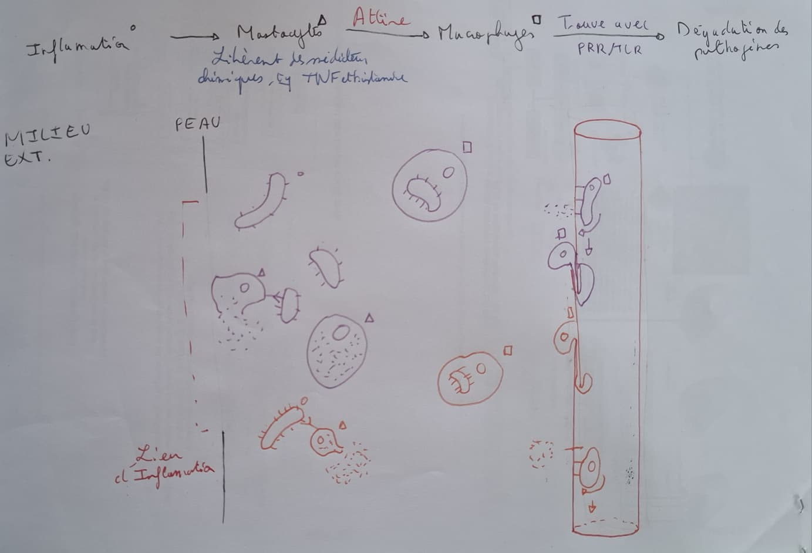

# Comment l'organisme se défend-il localement lors de l'introduction de micro-organismes pathogènes ? Comment expliquer les quatre symptômes de la réaction inflammatoire ?

## Rôle des récepteurs PRR

### 1. Étudier les documents ressources sur le rôle des récepteurs PRR.

Les PRR sont des récepteurs membranaires ou intracellulaires qui reconnaissent des motifs moléculaires caractéristiques des micro-organismes, appelés PAMP. Ces motifs sont absents chez l'hôte et spécifiques à chaque groupe de micro-organismes.

### 2. Réaliser une visualisation moléculaire en 3D...

*(À compléter selon vos observations sur logiciel de modélisation moléculaire)*

### 3. Repérer le rôle et le mode d'action des récepteurs TLR...

Les TLR sont une sous-famille de récepteurs PRR situés à la surface des cellules immunitaires résidentes (comme les macrophages ou les cellules dendritiques). Leur activation par liaison aux PAMP déclenche des cascades de signalisation intracellulaire qui alertent la cellule de la présence d'un agent pathogène et stimulent la réponse immunitaire innée.

## Sécrétion et rôle des médiateurs chimiques

### 1. Étudier les documents ressources sur la libération de médiateurs chimiques. Expliquez comment ils sont libérés au niveau d'une plaie.

Au niveau d'une plaie, l'introduction de micro-organismes pathogènes stimule les **mastocytes**. Au contact des agents pathogènes (via leurs récepteurs), les mastocytes libèrent par exocytose des médiateurs chimiques préformés (comme l'histamine et des TNF) dans le milieu extracellulaire.

### 2. Étudier les documents ressources sur les effets de la libération de médiateurs chimiques...

Les principaux médiateurs chimiques et leurs effets sont :
- **L'histamine :** Provoque une vasodilatation (augmentation du diamètre et du débit sanguin des capillaires) et une augmentation de la perméabilité vasculaire, ce qui entraîne rougeur et chaleur, et stimule les fibres nerveuses sensitives provoquant la douleur.
- **Les prostaglandines :** Contribuent également à la vasodilatation, à l'augmentation de la perméabilité, renforcent la sensation de douleur par stimulation des fibres nerveuses, et agissent au niveau des centres hypothalamiques pour induire la fièvre.
- **Les cytokines (produites notamment par les cellules endothéliales et immunitaires) :** Activent les phagocytes et les leucocytes sanguins, et favorisent leur recrutement.
- **Les chimiokines :** Jouent un rôle de signal chimio-attractif en formant un gradient chimique qui guide les leucocytes (monocytes, neutrophiles) vers le tissu enflammé.Ces médiateurs sont indispensables pour déployer la réponse immunitaire innée locale, ce qui se manifeste physiologiquement par les quatre symptômes cardinaux de l'inflammation : la **rougeur**, la **chaleur**, le **gonflement** et la **douleur**.

## Recrutement des globules blancs

### 1. À partir des documents ressources, comparer les photographies de peau avant et après infection. Identifier le type de leucocytes observés.

Avant l'infection, les tissus contiennent principalement des cellules résidentes (mastocytes, macrophages, cellules dendritiques). Après l'infection, on observe un afflux massif de leucocytes recrutés depuis le sang, en particulier des **polynucléaires neutrophiles** et des **monocytes** (qui se différencient en macrophages dans les tissus).

### 2. Étudier les documents ressources afin d'expliquer comment les médiateurs chimiques permettent la colonisation...

Sous l'effet des médiateurs chimiques libérés par les mastocytes et les cellules résidentes, les cellules endothéliales des vaisseaux sanguins activent des molécules d'adhésion à leur surface. Les leucocytes circulant dans le sang ralentissent, adhèrent à la paroi, puis se déforment pour traverser la paroi des vaisseaux. Ils se dirigent ensuite vers le foyer infectieux pour éliminer les agents pathogènes.

## Phagocytose

### 1. Repérer sur le frottis sanguin... réaliser une capture d’image et l’annoter.

Les leucocytes sont les cellules bleues.

### 2. Expliquer ce qu’est la phagocytose et quel est son intérêt...

La phagocytose est un mécanisme cellulaire au cours duquel un globule blanc (comme un macrophage) englobe et détruit un agent pathogène à l'intérieur d'une vacuole digestive grâce à des enzymes (merci le cours de l'année dernière). Son intérêt est d'éliminer rapidement l'élément étranger pour nettoyer les tissus, et de pouvoir présenter des fragments antigéniques aux lymphocytes T pour une réponse immunitaire personalisée.

### 3. Expliquer ce qui déclenche la phagocytose, pourquoi ce mécanisme n’est pas spécifique...

La phagocytose est déclenchée par la reconnaissance directe ou indirecte des **PAMP** microbiens par les récepteurs **PRR** présents à la surface des phagocytes. Ce mécanisme n'est pas spécifique car un même récepteur PRR peut reconnaître des motifs moléculaires communs partagés par de multiples espèces de micro-organismes pathogènes différents, permettant ainsi au phagocyte d'ingérer une grande variété d'agents étrangers.

## Bilan

Lors d'une inflammation, des agents pathogènes rentre dans notre milieu extra-cellulaire. Au contact des Mastocytes, on observe une libération de différents médiateurs chimiques (TNF/histamine) qui vont appeler les autres globules blancs (leucocytes) sur le lieu de l'inflamation. L'histamine permet un flux sanguin plus rapide. La cytokine permet l'appel des leucocytes dans les vaiseaux sanguins par un double message : les protéines sur les parroies des vaiseaux (cellules epithéliales) appellent des leucocytes, qui vont se coller et se déplacer sur le long de la parroie jusqu'à trouver un espace pour s'y glisser et sortir dans l'espace intracellulaire. C'est ensuite les chimiokines qui attirent les leucocytes vers le lieu d'inflamation pour qu'ils réalisent la phagocytose. Ces sécrétions de médiateurs chimiques entraines cependant des réactions secondaires  
Pour se débarasser des bactéries, les macrophages effectuent de la phagocytose : ils abosrbent les pathogènes pour les disoudres dans leurs cytosole (vacuoles & enzymes) et 

> Les bactéries, mastocytes et macrophages sont notés avec des cercles, rectangles et carrés.

> [!quote] Fiche rédigé par Guilhem CANIS. Compilé par [fiches.me](https://fiches.funa.dev/cpes2/bio/td) le 12 Octobre 2026 à 16h06.
